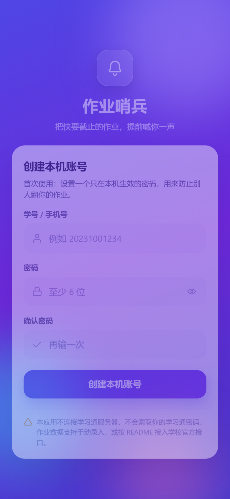
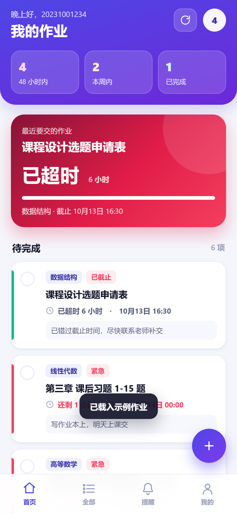
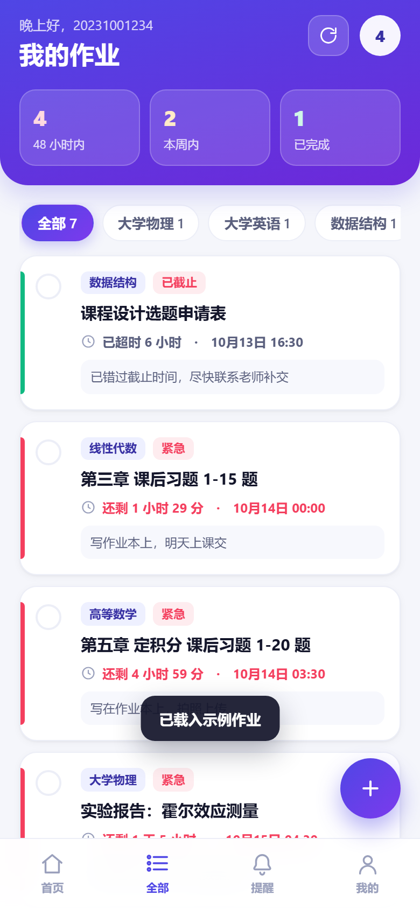
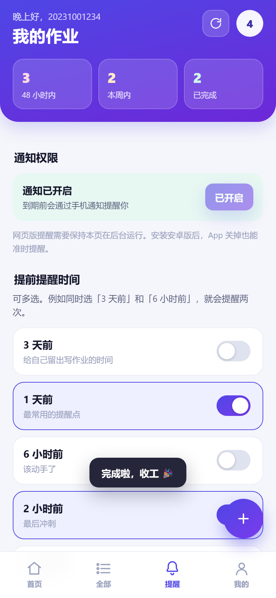
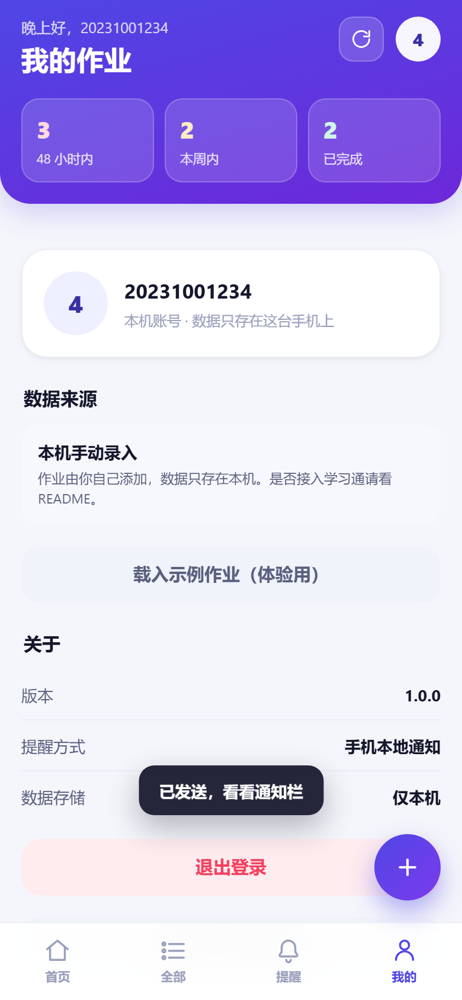
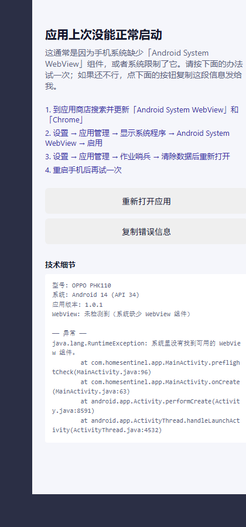

# 作业哨兵 · Homework Sentinel

把快要截止的作业，提前喊你一声。

一个只在手机上运行的作业截止提醒应用：自己录入作业（或接学校官方接口），到点前用**手机系统通知**提醒你，可以精确到「3 天前 / 1 天前 / 6 小时前 / 2 小时前 / 30 分钟前」五个档位，还支持每日早报和夜间免打扰。

> 安卓版走系统闹钟，**App 关掉、甚至被系统清理，提醒照样准时弹出来**。

---

## 目录

- [它解决什么问题](#它解决什么问题)
- [界面预览](#界面预览)
- [功能](#功能)
- [两种用法](#两种用法)
- [怎么装到手机上](#怎么装到手机上)
- [自己从源码打包](#自己从源码打包)
- [提醒是怎么工作的](#提醒是怎么工作的)
- [关于「登录学习通」这件事（请务必看）](#关于登录学习通这件事请务必看)
- [数据存在哪里](#数据存在哪里)
- [目录结构](#目录结构)
- [常见问题](#常见问题)
- [上传到 GitHub](#上传到-github)
- [许可](#许可)

---

## 它解决什么问题

老师在学习通上布置作业 → 消息被淹没 → 想起来的时侯已经截止了。

作业哨兵只做一件事：**盯着截止时间，在你自己选的时刻把你叫醒**。
它不抢学习通的活，不替你交作业，只负责在恰当的时间提醒你一次。

---

## 界面预览

| 登录 | 首页 | 全部作业 | 提醒设置 | 我的 |
| --- | --- | --- | --- | --- |
|  |  |  |  |  |

配色用的是靛蓝紫渐变 + 纯白卡片，五种紧急状态各有自己的颜色：

| 状态 | 颜色 | 含义 |
| --- | --- | --- |
| 已截止 | 🔴 玫红 | 已经过了截止时间 |
| 紧急 | 🔴 玫红 | 48 小时内要交 |
| 接近 | 🟠 琥珀 | 7 天内要交 |
| 充裕 | 🟢 翠绿 | 还有一周以上 |
| 已完成 | ⚪ 灰色 | 打过勾了 |

---

## 功能

**作业管理**

- 手动添加 / 编辑 / 删除作业，字段有：标题、课程、截止时间、备注
- 点圆圈打勾即完成，已完成自动收纳到下面
- 按课程筛选，顶部三个数字卡片可以一键跳到「48 小时内 / 本周内 / 已完成」
- 首页顶部有一张「最近要交的作业」大卡，实时倒计时 + 进度条
- 内置示例数据，第一次用可以先载入看看效果

**提醒**

- 五档「提前提醒」可多选，比如同时选「1 天前」和「2 小时前」，就会提醒两次
- 截止那一刻额外再提醒一次
- 每日早报：每天早上把今明两天要交的作业汇总成一条通知
- 夜间免打扰：23:00–07:00 的提醒自动顺延到早上，不会半夜震你
- 一键发测试通知，确认权限有没有配好

**账号**

- 本机账号：设置一个只在这台手机上生效的密码，防止别人翻你的作业
- 密码经过哈希后保存，不会以明文形式存在手机里
- 数据只在本机，换手机不会同步（也就不会泄露）
- 忘记密码：双击登录页标题即可清空本机数据重来

---

## 两种用法

### 方式一：安卓 App（推荐，提醒最可靠）

打包出来是一个 APK，装到手机上就是一个正常应用。
提醒交给**系统闹钟**，App 不用常驻后台，关掉也能准时提醒。

### 方式二：网页版（免安装，适合先在电脑上看效果）

直接打开 `app/index.html` 就是一个完整的手机网页应用，用手机浏览器打开后
可以「添加到主屏幕」，看起来和 App 一样，而且断网也能用（有离线缓存）。

需要注意的是：**网页版只有在页面开着的时候才能提醒你**——浏览器不允许后台网页
在关闭后自己跑定时器。想要「关掉也能提醒」，请用方式一的安卓版。

---

## 怎么装到手机上

### 安卓

**直接下载安装包：**

👉 [homework-sentinel-v1.0.3.apk](https://github.com/Jeansmr/homework-sentinel/releases/download/v1.0.3/homework-sentinel-v1.0.3.apk)

也可以打开 [Releases 页面](https://github.com/Jeansmr/homework-sentinel/releases) 下载，
或者按下面的步骤自己打包。

1. 把 APK 传到手机（微信文件传输助手 / QQ / 数据线都行）
2. 点击安装，系统提示「来自未知来源」时选择允许（这是自己签名的应用，正常现象）
3. 首次打开会请求**通知权限**，一定点「允许」，否则提醒收不到
4. 部分手机（小米、华为、OPPO、vivo）还需要额外给「自启动」和「后台运行」权限，
   否则系统会把闹钟清掉。路径一般在：设置 → 应用管理 → 作业哨兵 → 权限

> 安装包最低支持安卓 7.0（API 24），使用 v2 签名方案，绝大多数手机直接可装。
> 如果以后要把 `minSdk` 降到 23 或更低，请先在 `android/app/build.gradle.kts` 里
> 为签名配置打开 `enableV1Signing`。

#### 如果打开就闪退

**先确认装的是 v1.0.1 或更新版本。** v1.0.0 的启动代码没有异常保护，
当系统缺少「Android System WebView」组件时会直接闪退，且看不到原因。

v1.0.1 起做了这些事：

- 启动前先检查 WebView 是否可用，不可用就告诉你原因
- 启动全程有异常保护，任何一步出错都显示错误页而不是闪退
- 未捕获的异常会写进本地文件，下次打开直接把原因显示出来
- 错误页上有「重新打开应用」和「复制错误信息」两个按钮

**最常见的闪退原因是系统 WebView 被禁用或被精简**，恢复办法：

1. 到应用商店搜索并更新「Android System WebView」和「Chrome」
2. 设置 → 应用管理 → 显示系统程序 → Android System WebView → 启用
3. 设置 → 应用管理 → 作业哨兵 → 清除数据后重新打开
4. 重启手机后再试

完整的排查过程记录在 [docs/闪退排查记录.md](docs/闪退排查记录.md)。

**如果错误页出现了**，点「复制错误信息」把内容发出来，就能直接定位到具体原因
（错误页里包含手机型号、系统版本、WebView 版本和完整堆栈）。

**如果连错误页都没出现**，用数据线连电脑抓一份日志：

```powershell
# 手机先开启「开发者选项 → USB 调试」，然后：
powershell -ExecutionPolicy Bypass -File tools\抓崩溃日志.ps1
```

脚本会自动找到手机、读取 WebView 组件状态、抓取崩溃堆栈，
并在桌面生成 `崩溃日志.txt`。把那个文件发出来即可。

它长这样（`app/_errorpage-preview.html` 是同一套文案的可视预览）：



#### 如果打开是白屏 / 一片空白

**先确认装的是 v1.0.2 或更新版本。** v1.0.1 只防住了「抛异常」这一种失败，
而网页加载失败、渲染进程被回收这类问题**一个异常都不会抛**，
WebView 会安安静静显示一片空白，代码里没有任何地方会知道。

v1.0.2 起，屏幕上任何时刻都会有东西：

- 启动时先显示「正在启动，请稍候…」，确认界面画出来了才撤掉
- 页面加载失败、返回错误码、渲染进程被杀，都会显示具体原因
- 15 秒还没起来，会在页面上写出已等待秒数 + 自检结果
  （`readyState` / 脚本有没有跑起来 / 本地存储能不能用）
- 加载前先检查安装包里的界面文件读不读得到，读不到就直接报错
- 网页脚本报错也会被捕获并显示出来
- 已开启远程调试：手机连电脑后 `chrome://inspect` 可直接查看这个页面

如果你看到的是**一直停在「正在启动，请稍候…」**，说明安装包里的
界面文件没能跑起来，按顺序试：

1. 卸载后重新安装这个 APK（安装包可能没装完整）
2. 到应用商店更新「Android System WebView」和「Chrome」
3. 设置 → 应用管理 → 显示系统程序 → Android System WebView → 启用
4. 重启手机

超过 15 秒后页面上会出现一段自检信息，**把那一屏截图发出来**就能定位。

完整的排查过程记录在 [docs/白屏排查记录.md](docs/白屏排查记录.md)。

#### 如果打开先弹「E140 WebView 配置失败」，点一下「重新加载界面」才能进

**先确认装的是 v1.0.3 或更新版本。** v1.0.2 的问题在于：
安卓清单里没有声明 `INTERNET` 权限，而 WebView 的
`setBlockNetworkLoads(false)` 在没有这个权限时会抛
`SecurityException: Permission denied - application missing INTERNET permission`。

这条异常本身只影响一个无关紧要的设置项，但它排在配置流程中间，
一抛就把后面的「挂 WebViewClient、挂 JS 桥」一起带走，
页面于是永远停在启动占位层，只能靠手动点一次「重新加载界面」重来。

v1.0.3 分三层修掉了它：

- 清单补上 `INTERNET` 权限（**用 WebView 就必须声明**，哪怕界面一个字都不联网；
  应用仍然显式 `setBlockNetworkLoads(false)`，主动禁止联网加载）
- 配置流程重排：先做「不做就没法用」的（JavaScript、WebViewClient），
  再做可选项，且每个可选项单独 try/catch，坏一个不牵连其它
- `E140` 从「当场判死刑」降级为「可恢复」：继续加载页面，
  页面起来了就自动消失，不需要用户点任何按钮

升级后如果**仍然**看到这张错误页，点「复制错误信息」把内容发出来即可。

完整的排查过程记录在 [docs/WebView配置失败排查记录.md](docs/WebView配置失败排查记录.md)。

### 网页版

把 `app/` 目录放到任意静态服务器上，或者本地打开：

```bash
node tools/serve.js
# 然后手机浏览器访问 http://<电脑局域网IP>:4180/
```

---

## 自己从源码打包

### 需要准备

| 工具 | 版本 | 说明 |
| --- | --- | --- |
| JDK | 17 或更高 | 需设置环境变量 `JAVA_HOME` |
| Android SDK | platform 34 + build-tools 34.0.0 | 命令行工具即可，不必装 Android Studio |
| Node.js | 18 或更高 | 只用于本地预览和自动化测试 |

### Windows

```powershell
# 1. 装 Android SDK 组件（只需一次）
powershell -ExecutionPolicy Bypass -File tools\install-android-sdk.ps1

# 2. 生成签名密钥（只需一次）
powershell -ExecutionPolicy Bypass -File tools\make-keystore.ps1

# 3. 打包
powershell -ExecutionPolicy Bypass -File tools\build-android.ps1
```

产物在 `android/app/build/outputs/apk/release/app-release.apk`，
构建脚本也会把它复制一份到仓库根目录，方便直接传到手机。

### macOS / Linux

```bash
export JAVA_HOME=/path/to/jdk17
export ANDROID_HOME=$HOME/Android/Sdk

bash tools/build-android.sh
```

### 用 Android Studio（最省事）

直接 `File → Open` 打开 `android/` 目录，等 Gradle 同步完，点绿色三角运行即可。
Studio 会自己找到 SDK，不用管 `local.properties`。

### 重新生成应用图标

图标是用 Python + Pillow 画出来的（不依赖 cairo 之类的原生库）：

```bash
python tools/make_icons.py
```

改 `tools/make_icons.py` 里的颜色和形状就能换成你自己的图标，脚本会一次生成
网页用图和安卓各分辨率的启动图标。

---

## 提醒是怎么工作的

这是这个项目里最值得说清楚的部分。

```
网页层（app/app.js）
  │  planReminders()  纯函数，算出「什么时间、提醒哪份作业、说什么话」
  │  结果形如 [{ key, hwId, title, body, at }]
  ↓
  ├─ 网页版：前台每 30 秒检查一次，到点用 Notification API 弹通知
  │
  └─ 安卓版：通过 JS 桥把计划交给原生层
                ↓
        MainActivity.NativeBridge.syncReminders(json)
                ↓
        ReminderStore 存进 SharedPreferences（重启也不丢）
                ↓
        ReminderScheduler 用 AlarmManager 登记精确闹钟
                ↓
        到点 → ReminderReceiver 被系统唤醒 → 弹通知
```

几个细节：

- **去重**：每条提醒有个 `key`（`作业id@档位`），同一条只会弹一次
- **免打扰顺延**：先算出提醒时刻，如果落在免打扰区间，就顺延到区间结束的那一刻
- **重启恢复**：`BootReceiver` 监听开机广播，开机后把所有提醒重新登记一遍
- **改了就重算**：任何作业或设置变更都会触发 `persist()`，重新生成计划并同步给原生层
- **精确闹钟**：Android 12+ 需要 `SCHEDULE_EXACT_ALARM` 权限；拿不到时自动退化为
  「尽量准时」（`setAndAllowWhileIdle`），不会崩溃

---

## 关于「登录学习通」这件事（请务必看）

**这个应用不会、也不应该拿你的学习通账号密码去登录超星服务器。**

原因很实在：

1. 学习通（超星）**没有面向个人开发者的公开接口**。任何第三方 App 想拿作业数据，
   都只能模拟登录 + 抓私有接口，这属于绕过官方鉴权。
2. 这违反《超星学习通用户协议》，账号有被风控、冻结的风险。
3. 把学习通密码交给一个来历不明的 App，本身就是很危险的事——这也是为什么本项目
   连自己的密码都只存哈希。

### 那想自动同步作业怎么办？

走官方路子，任何一条都比自己抓接口靠谱：

| 途径 | 说明 |
| --- | --- |
| 学校教务/信息中心 | 很多学校已经和超星对接，可以问是否提供作业数据接口 |
| 超星开放平台 | 以学校或机构名义申请应用授权（个人一般申请不下来） |
| 老师发的课表 / 作业清单 | 让助教导出一份 Excel，导入进来 |
| 学习通自带的提醒 | 学习通本身有 DDL 提醒，可以和本应用叠加使用 |

### 代码里已经留好了位置

数据来源被抽象成了一个「来源」概念，网页层只认 `homework` 数组：

```js
{ id, title, course, due, note, done, createdAt }
```

只要能把数据变成这个结构，就能接进来。具体做法：

1. 在 `app/app.js` 里新增一个 `Source` 对象，实现 `fetch()` 返回上述数组
2. 在「我的 → 数据来源」里展示来源名称（安卓侧对应
   `MainActivity.NativeBridge.sourceName()` / `sourceDesc()`）
3. 如果你确实拿到了官方授权，把 token 存在
   `Android EncryptedSharedPreferences` 或系统钥匙串里，**不要**放进 localStorage

在拿到官方授权之前，请老老实实用手动录入——一份作业录入只要 10 秒，
但省下的是账号被冻结的麻烦。

---

## 数据存在哪里

| 平台 | 位置 | 内容 |
| --- | --- | --- |
| 网页版 | 浏览器 `localStorage` 的 `hw_sentinel_v1` | 账号哈希、作业列表、提醒设置 |
| 安卓版 | WebView 的 localStorage（同上）+ `SharedPreferences` | 前者存业务数据，后者存提醒计划供闹钟读取 |

- **不联网**：整个应用没有任何网络请求，没有埋点，没有统计 SDK
- **不上传**：没有任何服务器，数据出不了这台手机
- **可清除**：我的 → 清除本机全部数据，或者双击登录页标题

---

## 目录结构

```
作业结束提醒/
├── app/                         网页界面（唯一的一份界面代码）
│   ├── index.html               页面结构
│   ├── styles.css               样式（含设计变量）
│   ├── app.js                   全部逻辑：存储、提醒计划、渲染、事件
│   ├── sw.js                    Service Worker，离线缓存
│   ├── manifest.webmanifest     PWA 清单，可添加到主屏幕
│   ├── icons/                   应用图标
│   ├── selftest.html            界面自测页（本地看效果用，不打包进 APK）
│   ├── _frame.html              开发用：390px 手机宽度预览
│   └── _diag.html               开发用：布局溢出诊断
│
├── android/                     安卓原生工程（WebView + 系统闹钟）
│   ├── app/src/main/
│   │   ├── java/com/homesentinel/app/
│   │   │   ├── MainActivity.java        WebView 容器 + JS 桥
│   │   │   ├── ReminderScheduler.java   登记系统闹钟
│   │   │   ├── ReminderStore.java       提醒计划持久化 + 稳定 id
│   │   │   ├── ReminderReceiver.java    到点弹通知
│   │   │   ├── BootReceiver.java        开机后恢复提醒
│   │   │   ├── NotificationHelper.java  通知渠道与通知
│   │   │   ├── AppContext.java          全局 Context
│   │   │   └── Prefs.java               SharedPreferences 封装
│   │   ├── res/                         图标、主题、颜色、字符串
│   │   ├── assets/www/                  由脚本从 app/ 同步过来
│   │   └── AndroidManifest.xml
│   ├── keystore/                本地签名密钥（不提交到 Git）
│   └── build.gradle.kts
│
├── tools/
│   ├── serve.js                 本地静态服务器
│   ├── verify.js                Playwright 端到端验证（18 项检查 + 截图）
│   ├── blank-screen-test.mjs    白屏回归测试（零依赖，直接驱动 CDP）
│   ├── cdp-webtest.mjs          用真实手机视口跑一遍登录后的主界面
│   ├── check-android.ps1        安卓端编译自检（不需要 Gradle）
│   ├── make_icons.py            生成应用图标
│   ├── install-android-sdk.ps1  一键装 SDK 组件
│   ├── make-keystore.ps1        生成签名密钥
│   ├── build-android.ps1        一键打包（Windows）
│   ├── build-android.sh         一键打包（macOS / Linux）
│   └── 抓崩溃日志.ps1            一键抓手机 logcat 崩溃堆栈
│
├── scripts/
│   └── sync-web-to-android.ps1  把 app/ 同步进安卓工程
│
└── docs/
    ├── 闪退排查记录.md            v1.0.0「点开就闪退」的完整排查过程
    ├── 白屏排查记录.md            v1.0.1「点开是白屏」的完整排查过程
    ├── WebView配置失败排查记录.md  v1.0.2「先弹 E140 错误页」的完整排查过程
    └── screenshots/             界面截图
```

---

## 开发与测试

界面代码只有一份（`app/`），安卓端通过 `scripts/sync-web-to-android.ps1`
把它复制进 `assets/www`，所以改界面不用碰安卓代码。

### 本地预览

```bash
node tools/serve.js
# http://127.0.0.1:4180/            正常入口
# http://127.0.0.1:4180/selftest.html  载入示例数据后逐页查看
```

### 端到端验证

`tools/verify.js` 用 Playwright 驱动本机 Chrome，以真实的 390×844 手机视口
跑完整流程，并逐页截图、逐页检查有没有横向溢出：

```bash
npm install playwright-core        # 可选依赖，只跑测试才需要
node tools/serve.js &
node tools/verify.js
```

它覆盖 18 项检查：表单校验、创建账号、添加作业、五种紧急状态统计、课程筛选、
勾选完成、五个提醒档位的开与关、每日早报、免打扰顺延、测试通知、
退出登录后数据保留、重新登录、密码错误提示。

最近一次运行结果：

```
=== 8. 提醒计划计算 ===
  生成了 18 条提醒计划，前 6 条：
    - 2026/10/14 07:00:00  「线性代数」今天截止！
    - 2026/10/14 07:30:00  今天有 3 份作业要交
    - 2026/10/14 22:30:54  「大学物理」6 小时前提醒
=== 9. 免打扰顺延 ===
  落在 23:00-07:00 的提醒条数 = 0（应为 0）
================ 验证结果 ================
全部通过
```

### 调试用的页面

| 文件 | 用途 |
| --- | --- |
| `app/selftest.html` | 写入示例数据后跳转，方便快速看各个页面 |
| `app/_frame.html` | 把应用放进 390px 宽的 iframe，用来模拟手机宽度 |
| `app/_diag.html` | 列出所有超出视口宽度的元素，排查布局溢出 |

这三个文件不会被同步进安卓工程（同步脚本会按 `_` 前缀和文件名排除）。

### 白屏回归测试

「点开是白屏、没有任何提示」是最难排查的一类故障：WebView 不抛异常、
不报错，只是安静地显示一片空白。这套测试把「界面起不来」的情况真的做出来，
确认屏幕上始终有给人看的文字：

```bash
node tools/serve.js &
node tools/blank-screen-test.mjs
```

| 场景 | 模拟的情况 |
| --- | --- |
| A | 一切正常 |
| B | JavaScript 完全没运行（关掉 Chrome 的脚本执行） |
| C | `app.js` 加载失败（复制一份 app/，真的把文件删掉） |

最近一次运行结果：

```
全部故障场景屏幕上都有内容，没有白屏 ✅
截图目录：.dev-shots/blank-test
```

它用 Node 内置的 WebSocket 直接驱动 CDP，**不需要 Playwright 等任何依赖**。
截图会写到 `.dev-shots/blank-test/`，可以直接看效果。

> 注意：不要用 CDP 的请求拦截来模拟加载失败——Service Worker 和缓存会把
> 拦截绕过去，测出来全是「假通过」。必须让文件真的读不到。

### 安卓端编译自检

改完安卓代码后，不用等 Gradle（它要联网下载 AGP），几秒钟就能确认能不能编过：

```powershell
powershell -ExecutionPolicy Bypass -File tools\check-android.ps1
```

1. 检查网页资源能否同步进 `assets/www`，入口文件是否完整
2. 用 `aapt` 编译资源、生成 `R.java`——资源或清单有问题在这里暴露
3. 用 `javac` 对着真正的 `android.jar` 编译全部 Java

```
== 3/3  编译 Java（javac + android.jar）==
   OK   编译通过，生成 35 个 class
安卓端自检全部通过。
```

它**不打包 APK**——正式出包仍然用 `tools\build-android.ps1`（走 Gradle）。

---

## 常见问题

**Q：装的时候提示「未知来源」，安全吗？**
A：安全。因为这个 APK 是用项目自带的密钥自己签名的，不是从应用商店装的，
所以系统会提示一次。你可以断开网络使用——它没有任何联网行为。

**Q：提醒不响怎么办？**
按顺序检查：
1. 系统设置 → 应用 → 作业哨兵 → 通知，确认已允许
2. 「提醒」页里点「发一条测试通知」，能收到说明权限没问题
3. 检查「提前提醒时间」是不是一个都没勾
4. 小米/华为/OPPO/vivo 需要在系统设置里额外允许「自启动」和「后台运行」
5. 如果作业的截止时间本身就在过去，那提醒时刻也已经过去了，不会补发

**Q：为什么网页版关掉浏览器就不提醒了？**
A：这是浏览器的限制，任何网页都做不到在完全关闭后自己跑代码。
想要可靠提醒请装安卓版。

**Q：换手机数据会同步吗？**
A：不会。数据只在本机，这是刻意设计——不上传就不会泄露。
换手机时旧手机上的数据可以用「我的」页面手动抄一份。

**Q：能不能自动从学习通同步作业？**
A：见上面[关于「登录学习通」这件事](#关于登录学习通这件事请务必看)。
简单说：不走官方授权就不做，保护的是你的账号。

**Q：怎么改配色？**
A：`app/styles.css` 顶部的 `:root` 里全是设计变量，改 `--brand` 和 `--brand-2`
就能换掉主色调。

---

## 上传到 GitHub

项目已经是一个初始化好的 Git 仓库。推到自己的账号上：

```bash
cd 作业结束提醒

# 方式一：用 GitHub CLI（最省事，会自动处理登录）
gh auth login
gh repo create homework-sentinel --public --source=. --push

# 方式二：先在网页上建一个空仓库，再关联
git remote add origin https://github.com/<你的用户名>/homework-sentinel.git
git branch -M main
git push -u origin main
```

如果 GitHub 要求密码，**不要输入账号密码**——GitHub 早就不支持了。
请到 `Settings → Developer settings → Personal access tokens` 生成一个 token，
用它当密码；或者配置 SSH key：

```bash
ssh-keygen -t ed25519 -C "你的邮箱"
# 把 ~/.ssh/id_ed25519.pub 的内容贴到 GitHub → Settings → SSH keys
git remote set-url origin git@github.com:<你的用户名>/homework-sentinel.git
git push -u origin main
```

`android/local.properties` 和 `android/keystore/` 已经在 `.gitignore` 里，
不会把本机路径和签名密钥传上去。

---

## 许可

MIT License，随便用、随便改。详见 [LICENSE](LICENSE)。

如果你也总是忘作业，希望这个小工具能救你几次。
